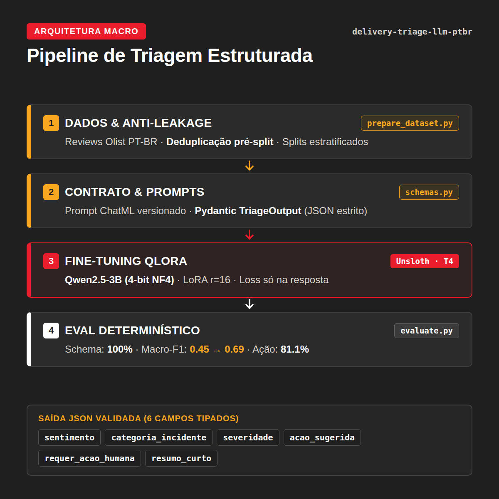
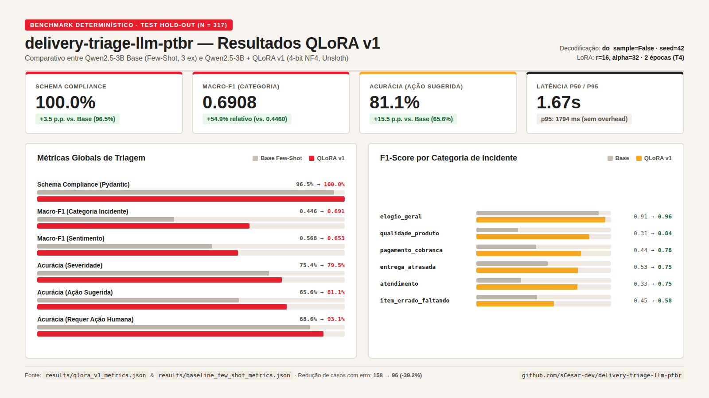

# delivery-triage-llm-ptbr

Fine-tuning de um LLM compacto (**Qwen2.5-3B-Instruct** via **QLoRA 4-bit NF4**) para triagem operacional de reviews e incidentes de delivery em português brasileiro com saída em **JSON estrito** validado por **Pydantic v2**.



## Problema e Contrato de Saída

Em operações de delivery em escala, depender de modelos proprietários grandes para triagem simples eleva custo e latência e introduz variações de formato. Este projeto especializa um modelo 3B para converter reviews livres em PT-BR em um contrato determinístico (`TriageOutput` em `src/schemas.py`):

- `sentimento`: `positivo` | `neutro` | `negativo`
- `categoria_incidente`: `entrega_atrasada` | `item_errado_ou_faltando` | `qualidade_produto` | `atendimento` | `pagamento_cobranca` | `elogio_geral` | `outro`
- `severidade`: `baixa` | `media` | `alta` | `critica`
- `requer_acao_humana`: `bool`
- `acao_sugerida`: `nenhuma` | `acompanhar` | `estorno_parcial` | `estorno_total` | `escalar_suporte`
- `resumo_curto`: frase objetiva (3–240 caracteres)

## Resultados (Conjunto `test` — 317 amostras)

Avaliação determinística (`do_sample=False`, `seed=42`) comparando o modelo base com 3 exemplos (*Few-Shot*) frente ao modelo especializado com **QLoRA v1** (`r=16`, `lora_alpha=32`, 2 épocas, `train_on_responses_only=True`):



| Modelo / Configuração | JSON Valid | Schema Valid | Macro-F1 (Categoria) | Macro-F1 (Sentimento) | Acc (Severidade) | Acc (Ação) | Latência p50 / p95 (ms) |
| :--- | :---: | :---: | :---: | :---: | :---: | :---: | :---: |
| `Qwen2.5-3B` Base (Few-Shot, 3 ex) | 100.0% | 96.5% | 0.4460 | 0.5680 | 75.4% | 65.6% | 1657 / 1794 |
| `Qwen2.5-3B` + **QLoRA v1** | **100.0%** | **100.0%** | **0.6908** | **0.6527** | **79.5%** | **81.1%** | 1671 / 1794 |

Principais artefatos em [`results/`](results/):
- [Resumo comparativo](results/benchmark_summary.md)
- [Curva de loss (treino vs. validação)](results/qlora_v1_loss_curve.png)
- [Matriz de confusão — QLoRA v1](results/confusion_matrix_qlora_v1.png)
- [Métricas completas JSON](results/qlora_v1_metrics.json)

## Arquitetura do Projeto

```text
delivery-triage-llm-ptbr/
├── configs/
│   └── train_qlora_v1.yaml       # Hiperparâmetros versionados (Unsloth 4-bit NF4)
├── docs/
│   ├── arquitetura_macro.png     # Visão macro do pipeline
│   └── benchmark_results.png     # Painel consolidado de métricas
├── notebooks/
│   └── colab_train_unsloth.ipynb # Execução reproduzível em GPU T4 (15 GB)
├── results/                      # Métricas, matrizes de confusão, loss e erros
├── src/
│   ├── schemas.py                # Contrato Pydantic v2 e parser determinístico
│   ├── prompts.py                # System prompt versionado + builder ChatML
│   ├── data/prepare_dataset.py   # Download Olist PT-BR, anti-leakage e split estratificado
│   ├── train/train_qlora.py      # Fine-tuning QLoRA com train_on_responses_only
│   └── eval/
│       ├── evaluate.py           # Eval harness determinístico e benchmark_summary.md
│       └── error_analysis.py     # Sumarização de padrões de erro
└── tests/
    ├── test_data_leakage.py
    ├── test_evaluate.py
    └── test_schemas.py
```

## Como Executar Localmente

```bash
# Instalar dependências de desenvolvimento
make install

# Rodar suíte de testes unitários e anti-leakage
make test

# Verificar lint (ruff)
make lint

# Regenerar tabela resumo a partir dos JSONs em results/
make eval-report
```
